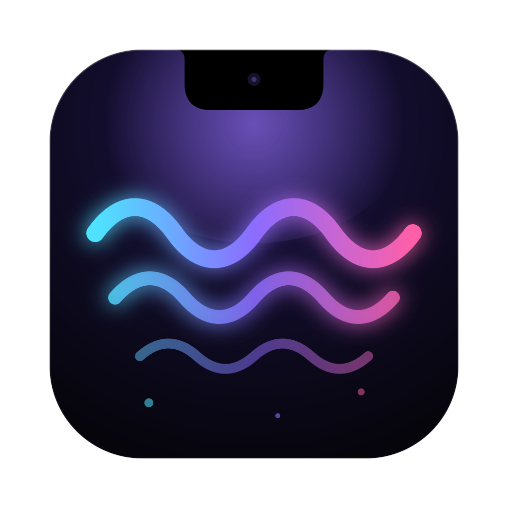

<h1 align="center">Drift</h1>

Your notch, finally useful. Music with synced lyrics, a file tray, calendar, tools and live activities in the MacBook notch.

## Develop
macOS 13+, Xcode or the Command Line Tools.

    make run              # build build/Drift.app and launch it

## Versioning
`VERSION` holds the marketing version (1.2.3), `BUILD_NUMBER` the build Sparkle compares.

    make patch | make minor | make major     # bump, commit, tag vX.Y.Z

## Releasing (auto-update to everyone)
One-time setup:

    brew install gh && gh auth login
    make setup-updates     # Sparkle tools + signing key (public key goes in Info.plist)

Then each release:

    make release           # or release-minor / release-major

That bumps the version, builds, makes `Drift-X.Y.Z.zip` (for updates) and `Drift.dmg` (for the website),
publishes a GitHub Release, and adds the version to `docs/appcast.xml`. Installed apps check that feed
daily (or via Check for Updates…) and offer the update.

## Website
`docs/` is the landing page and update feed. Turn on GitHub Pages: repo Settings → Pages → Deploy from
branch `main`, folder `/docs`. It goes live at https://faatehsultan.github.io/drift/.

## Layout
- `Sources/Drift/Music`: YouTube Music API client and parsers
- `Sources/Drift/Playback`: audio engine and player/queue
- `Sources/Drift/Notch`: notch window, shape, state
- `Sources/Drift/Features`: calendar, tray and converter, tools, lyrics, Claude Code approvals
- `Sources/Drift/UI`, `Sources/Drift/Settings`: every screen
